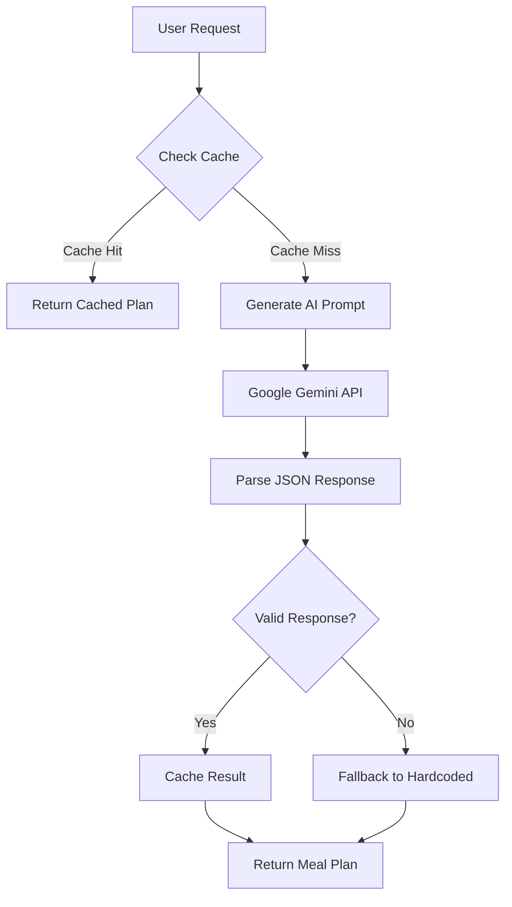

# AI-Powered Meal Plan Generation

## Overview

Replace the hardcoded meal database in `services/mealPlanner.js` with AI-generated meal plans using Google Gemini API (free tier - 60 requests/minute). Implement intelligent caching and fallback mechanisms.

## Architecture




## Implementation Steps

### 1. Install AI SDK Dependencies

- Add `@google/generative-ai` for Gemini (free tier)
- Add `openai` package for OpenAI (fallback option)
- Update `package.json`

### 2. Create AI Service Module

**File:** `services/aiMealGenerator.js`

- Function to generate meal plans via Google Gemini API
- Structured prompts for consistent JSON output
- Error handling and retry logic
- JSON mode support for reliable parsing

### 3. Update Meal Planner Service

**File:** `services/mealPlanner.js`

- Replace hardcoded `mealDatabase` with AI calls
- Keep `generateWeeklyMealPlan()` function signature
- Add caching layer (in-memory or MongoDB)
- Fallback to hardcoded meals if AI fails

### 4. Environment Configuration

**File:** `.env.example` and `.env`

- Add `GOOGLE_AI_API_KEY` (Gemini)
- Add `OPENAI_API_KEY` (optional fallback)
- Add `AI_SERVICE` (gemini/openai)
- Add `ENABLE_AI_CACHE` (true/false)

### 5. Caching Strategy

- Cache key: `weight_healthCondition` (e.g., "70_gallstones")
- Store in MongoDB or in-memory cache
- Cache duration: 24 hours (configurable)
- Reduce API calls for same inputs

### 6. Prompt Engineering

Create structured prompts that:

- Include weight and health conditions
- Request specific JSON format
- Include nutritional requirements
- Specify meal types (breakfast, lunch, dinner, snacks)
- Request ingredients, calories, macros

### 7. Response Parsing & Validation

- Parse AI JSON response
- Validate structure matches expected format
- Calculate totals (calories, macros)
- Handle malformed responses gracefully

### 8. Error Handling

- API rate limits → fallback to hardcoded
- Network errors → retry once, then fallback
- Invalid responses → fallback to hardcoded
- Log errors for debugging

## Files to Modify

1. **package.json** - Add AI SDK dependencies
2. **services/aiMealGenerator.js** - New AI service module
3. **services/mealPlanner.js** - Replace hardcoded data with AI calls
4. **.env.example** - Add AI API key configuration
5. **README.md** - Update with AI setup instructions

## AI Prompt Structure

```javascript
Generate a weekly meal plan for a person weighing {weight}kg with health condition: {condition}.

Requirements:
- 7 days (Monday-Sunday)
- Each day: breakfast, lunch, dinner, snacks
- Each meal: name, ingredients array, calories, protein, carbs, fat, fiber
- Health condition: {condition} (low-fat/diabetic/high-protein)
- Target daily calories: {calculated_calories}

Return JSON format matching:
{
  "weeklyPlan": {
    "monday": {
      "breakfast": {...},
      "lunch": {...},
      "dinner": {...},
      "snacks": [...]
    },
    ...
  }
}
```


## Cost Estimation

**Google Gemini (Free Tier):**

- 60 requests/minute free
- Perfect for development and small-scale use
- **Cost: $0**

**Note:** Google Gemini free tier is sufficient for most use cases. No additional costs expected.

## Benefits

1. **Dynamic meal plans** - No hardcoded limitations
2. **Personalized** - AI considers all factors
3. **Scalable** - Easy to add new health conditions
4. **Cost-effective** - Free tier covers most use cases
5. **Reliable** - Fallback ensures app always works

## Testing Strategy

1. Test with Gemini API (free tier)
2. Test fallback to hardcoded meals
3. Test caching mechanism
4. Test error handling (invalid API key, network errors)